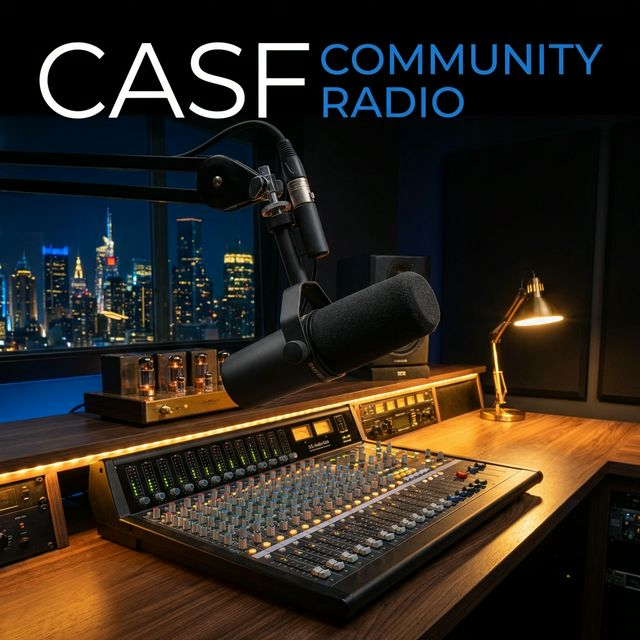

<p align="center">
  
</p>

<h1 align="center">CASF Community Radio</h1>

<p align="center">
  <strong>Live site: <a href="https://casfradio.ca">casfradio.ca</a></strong>
</p>

<p align="center">
  
  
  
  
</p>

The public website for CASF, the Central Valley community radio station. Listeners get the live stream, the weekly schedule, show pages, news, and song requests. Staff update that content from the control panel at `/admin/`.

## What the site includes

- Live player for the Citrus3 stream, with the current track and recently played songs
- Shows directory and individual show pages, including pictures, hosts, and descriptions
- Weekly schedule with the show that is on now
- News articles
- Song requests and a contact form
- Share buttons that post a show to Facebook with the show picture
- The station Facebook feed on the home page
- Control panel for shows, news, the schedule, image uploads, and listener analytics

## How it is hosted

The host is a HostGator Hatchling plan: Apache and PHP, with no Node.js process. `npm run build` writes a static site to `out/`. Anything that has to change after upload — login, saving shows, uploads, analytics — is a PHP script in `public/api/`. The browser calls those scripts directly.

`next.config.ts` stays on `output: 'export'`, `trailingSlash: true`, and `images.unoptimized: true`. Do not add Next.js route handlers, Server Actions, or server-rendered pages. They will not run on this host.

## Local development

```bash
npm install
copy .env.example .env
npm run dev
```

Open http://localhost:6767. The dev server starts a local PHP process and forwards `/api/*.php` to it, so the control panel behaves the same way it does on the host. The first run downloads a portable PHP into `tools/php`. That folder is gitignored.

`.env` is for local Google Analytics and stream settings. The control panel does not read it. Admin login is the PHP session in `public/api/bootstrap.php`.

## Deploy

1. Run `npm run build`.
2. Upload the contents of `out/` to the site root.
3. Leave these live folders alone. They hold the station's real content and are not in git:
   - `data/` (shows, news, schedule, messages, analytics)
   - `images/uploads/`

Do not upload `tools/`, `node_modules`, or the source tree. A full upload of `out/data/` would replace the live shows and news with the sample files in this repository.

Facebook caches link previews. After a change to `public/api/meta-bot.php`, scrape the show URL again in the [Sharing Debugger](https://developers.facebook.com/tools/debug/).

## Control panel

Sign in at `/admin/`. The username and password hash are in `public/api/bootstrap.php`. To change the password, generate a bcrypt hash and replace the value returned by `citrus_admin_password_hash()`:

```bash
php -r "echo password_hash('your-new-password', PASSWORD_BCRYPT), PHP_EOL;"
```

PHP's `password_verify` expects a `$2y$` hash. If the generator prints `$2b$`, change that prefix to `$2y$`.

Sessions are stored in `public/data/sessions` and are not served to the public.
